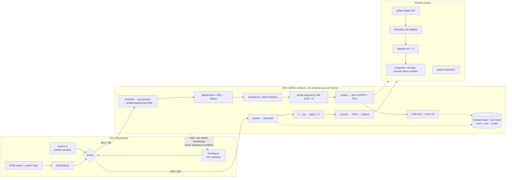

# flipgpu

**Real-time 3D fluid simulation in the browser, running entirely on the GPU in WebGPU compute shaders.**
A PIC/FLIP hybrid solver on a MAC staggered grid and a Position Based Fluids (SPH) solver share one
renderer, one UI and one set of scenes, so you can switch solvers and compare them directly.
No physics, math or rendering libraries: every kernel, transfer, solver, sort and shader is written by hand
in TypeScript and WGSL.

**Live demo:** [https://coopersimpson101-debug.github.io/flipgpu/](https://coopersimpson101-debug.github.io/flipgpu/) (needs a WebGPU browser: Chrome/Edge 113+, Safari 26+)

<!-- TODO for the author: record a GIF and put it at docs/media/dam-break.gif -->
> **GIF slot:** `docs/media/dam-break.gif` (not recorded yet, see [TODO for the author](#todo-for-the-author))

---

## Features

| | |
|---|---|
| **PIC/FLIP (primary)** | 3D MAC grid · trilinear P2G with **atomic 16.16 fixed-point accumulation** (WGSL has no float atomics) · cell marking · gravity, mouse and tank-shake body forces · free-slip solid walls + free surface · pressure projection with **Jacobi** or **red-black SOR** · optional explicit viscosity · G2P with a FLIP/PIC blend · **RK2** advection · particle push-out and volume (density) drift correction · **adaptive CFL substepping** from a GPU `atomicMax` of the speed |
| **PBF / SPH (secondary)** | Position Based Fluids (Macklin & Müller 2013) · poly6 density, spiky gradients · unilateral density constraint with CFM relaxation · artificial pressure `s_corr` · XSPH viscosity · **GPU spatial grid built by counting sort** (atomic count, multi-level prefix scan, scatter) |
| **Rendering** | Ray-cast **sphere impostors** with correct `frag_depth` · **screen-space fluid surface**: view-depth splat, additive thickness, separable **bilateral filter**, normal reconstruction from depth, **Schlick Fresnel** reflection/refraction and Beer–Lambert absorption |
| **Interaction** | Drag to push the fluid · Shift-drag to shake the tank (fictitious force −a<sub>tank</sub>) · orbit/zoom camera · hand-written HTML control panel · stats overlay with **GPU timestamp-query** timings · graceful fallback page when WebGPU is unavailable |
| **CPU reference + tests** | Double-precision 2D FLIP (incl. MIC(0)-preconditioned CG), 3D PBF, SPH kernels, counting sort and the GPU's blocked scan, all unit-tested with vitest |

## Architecture



```
src/
  main.ts               WebGPU init, frame loop, interaction, timestamp + CFL readback
  math.ts               mat4 / camera / ray helpers (tested)
  gpu/
    kernel.ts           explicit-layout compute kernel helper
    hashgrid.ts         GPU counting-sort grid (count → multi-level scan → scatter)
    flip.ts  pbf.ts     solver hosts (buffers, bind groups, dispatch order)
    renderer.ts         impostor + screen-space surface passes
    shaders/            flip.wgsl, pbf.wgsl, hashgrid.wgsl, scan.wgsl, render.wgsl
  cpu/
    flip2d.ts           2D PIC/FLIP reference (Jacobi, RB-SOR, MIC(0)-PCG)
    sph.ts              SPH kernels + 3D PBF reference
    spatial.ts          counting sort, blocked-scan emulation
  sim/  scenes.ts timestep.ts
  ui/   panel.ts style.css
tests/                  vitest suites
docs/gpu-pipeline.md    per-kernel dispatch list and buffer layout
```

## The physics

### Incompressible Navier–Stokes

For a liquid of constant density ρ, momentum and mass conservation read

$$
\frac{\partial \mathbf u}{\partial t} + (\mathbf u\cdot\nabla)\mathbf u = -\frac{1}{\rho}\nabla p + \nu\nabla^2\mathbf u + \mathbf g,
\qquad
\frac{\partial\rho}{\partial t} + \nabla\cdot(\rho\mathbf u) = 0 .
$$

With ρ constant along every material path (Dρ/Dt = 0), the continuity equation collapses to the
**incompressibility constraint** ∇·**u** = 0. Pressure is then not a thermodynamic variable but the
Lagrange multiplier that enforces this constraint.

### Operator splitting and Helmholtz–Hodge projection

Each step is split (Chorin 1968; Bridson 2015, ch. 2):

1. **Advection** `D u/Dt = 0`: done by moving particles (that is what removes the numerical diffusion of
   semi-Lagrangian grid advection).
2. **Body forces and viscosity**: **u**\* = **u** + Δt(**g** + ν∇²**u**).
3. **Projection**: **u**<sup>n+1</sup> = **u**\* − (Δt/ρ)∇p, with p chosen so that ∇·**u**<sup>n+1</sup> = 0.

Taking the divergence of step 3 gives the pressure Poisson equation

$$
\nabla^2 p = \frac{\rho}{\Delta t}\nabla\cdot\mathbf u^\* ,\qquad
p = 0 \text{ on the free surface},\qquad
\frac{\partial p}{\partial n} = \frac{\rho}{\Delta t}(\mathbf u^\* - \mathbf u_{\text{solid}})\cdot\hat n \text{ at walls}.
$$

This is the **Helmholtz–Hodge decomposition**: any smooth field splits uniquely into a divergence-free part
and a gradient, **u**\* = **u**<sub>div-free</sub> + ∇φ with φ = Δt p/ρ, and the projection simply removes the
gradient part. It is an orthogonal projection, so it never adds kinetic energy.

### Discretisation on the MAC grid

Pressure lives at cell centres and each velocity component on the faces normal to it (Harlow & Welch 1965).
The divergence of cell (i,j,k) is a sum of face differences,

$$
(\nabla\cdot\mathbf u)_{ijk} = \frac{u_{i+1,j,k}-u_{ijk} + v_{i,j+1,k}-v_{ijk} + w_{i,j,k+1}-w_{ijk}}{h},
$$

and for every FLUID cell the projection condition becomes the 7-point system

$$
\frac{\Delta t}{\rho h^2}\Big(n_{\text{ns}}\,p_{ijk} - \sum_{\text{fluid nbrs}} p_n\Big) = -(\nabla\cdot\mathbf u^\*)_{ijk},
$$

where n<sub>ns</sub> counts non-solid neighbours (solid faces drop out because their flux is prescribed, and air
neighbours contribute p = 0, the free-surface Dirichlet condition). The matrix is symmetric positive definite
whenever every connected fluid region touches air. On the GPU the pressure is stored pre-scaled,
p′ = pΔt/(ρh), so the projection is literally `u -= p'_i - p'_(i-1)`.

**Solvers.** Jacobi (`p ← (b + Σp_n)/n_ns`, ping-pong buffers) and red-black Gauss–Seidel with
over-relaxation ω (in place: the checkerboard colouring makes each half-sweep embarrassingly parallel).
The CPU reference additionally has conjugate gradient with a Modified Incomplete Cholesky MIC(0)
preconditioner (Bridson ch. 5); a GPU multigrid-preconditioned CG is on the roadmap.

### PIC, FLIP, and why we blend

Particles carry velocity; the grid is only used to make the field divergence-free.
- **PIC** (Harlow 1964) overwrites particle velocities with the interpolated grid velocity,
  v<sub>p</sub> ← I(**u**<sup>n+1</sup>). Every P2G→G2P round trip is a low-pass filter (averaging over ~8 particles per
  cell then re-interpolating), so PIC is stable but **strongly dissipative**: vortices and splashes die.
- **FLIP** (Brackbill & Ruppel 1986; Zhu & Bridson 2005) only transfers the *change*:
  v<sub>p</sub> ← v<sub>p</sub> + I(**u**<sup>n+1</sup> − **u**<sup>n</sup>). Sub-grid detail survives indefinitely, but so does
  sub-grid noise.
- The blend v<sub>p</sub> ← (1−α)·PIC + α·FLIP with α ≈ 0.95–0.99 keeps FLIP's lively motion while a few percent
  of PIC damps particle noise. The `FLIP ratio` slider is α.

The test suite demonstrates this quantitatively: with an unchanging grid, 10 round trips keep **100%**
(to 1e-10) of the particle kinetic energy for α = 1, and **less than 50%** for α = 0.

**Advection** uses midpoint RK2 through the projected grid field,
**x**<sub>mid</sub> = **x** + ½Δt **u**(**x**), **x**<sup>n+1</sup> = **x** + Δt **u**(**x**<sub>mid</sub>). Interpolation only uses faces
adjacent to a fluid cell (weights renormalised), which acts as a one-cell velocity extrapolation into air.

**Drift / volume correction.** FLIP particles slowly cluster and the discrete projection does not see
it. Two fixes run every substep: (1) a push-out pass separates particle pairs closer than 2r using the
counting-sort grid; (2) following the drift correction of the "Ten Minute Physics" FLIP demo, the
divergence target of over-dense cells is shifted by −κ·(ρ<sub>p</sub>−ρ<sub>0</sub>)/ρ<sub>0</sub>·h/Δt, so the projection
itself expands compressed regions (`Volume correction` = κ).

### Timestep: the CFL condition

Particles must not skip cells: Δt ≤ C·h / |**u**|<sub>max</sub>. FLIP tolerates C of a few cells (it is
unconditionally stable in the advection sense, but accuracy and the RK2 trajectories degrade), PBF needs
the particle spacing as length scale. Each frame the kernels `atomicMax` the particle speed (positive IEEE
floats sort like their bit patterns, so a `u32` atomic works), the value is read back asynchronously, and
the next frame uses `n = ceil(1.25·Δt_frame·|u|_max / (C·h))` substeps (clamped to 1–8; the 1.25 covers the
one-frame readback lag). Gravity waves add the limit Δt ≲ √(h/g), which is far looser here.

### SPH and Position Based Fluids

SPH estimates fields as kernel-weighted sums, ρ<sub>i</sub> = Σ<sub>j</sub> m W(**x**<sub>i</sub>−**x**<sub>j</sub>, h), with kernels
normalised to ∫W dV = 1 (verified numerically in the tests for poly6, spiky and the cubic spline in 2D and 3D):

$$
W_{\text{poly6}} = \frac{315}{64\pi h^9}(h^2-r^2)^3,\qquad
\nabla W_{\text{spiky}} = -\frac{45}{\pi h^6}(h-r)^2\,\hat{\mathbf r}.
$$

PBF (Macklin & Müller 2013) treats incompressibility as a per-particle constraint
C<sub>i</sub> = ρ<sub>i</sub>/ρ<sub>0</sub> − 1 and solves it with Newton-like Jacobi iterations on predicted positions:

$$
\lambda_i = -\frac{C_i}{\sum_k |\nabla_{\mathbf x_k} C_i|^2 + \varepsilon},\qquad
\Delta\mathbf x_i = \frac{1}{\rho_0}\sum_j\left(\lambda_i+\lambda_j+s_{\text{corr}}\right)\nabla W_{\text{spiky}}(\mathbf x_i-\mathbf x_j),
$$

with s<sub>corr</sub> = −k(W(r)/W(Δq))⁴ (artificial pressure against tensile clumping), ε a constraint-force-mixing
relaxation, and velocities from v = (**x**\*−**x**)/Δt followed by XSPH smoothing. The constraint is applied
**unilaterally** (only C > 0): with the bilateral form the CPU reference showed particles exceeding the
free-fall bound √(2gH) by ~50% (artificial energy from surface attraction); a regression test now checks it.

**Neighbour search by counting sort:** `atomicAdd` per-cell counts (the return value is the particle's slot),
an exclusive prefix sum over cells (multi-level Hillis–Steele scan in workgroup memory, block sums scanned
recursively), then a scatter. Particles of cell c are `sorted[start[c] .. start[c+1])`. The CPU emulation
of the exact blocked-scan structure is tested against a sequential scan for sizes up to 70k.

### Rendering

Impostors: one instanced camera-facing quad per particle; the fragment shader intersects the view ray
with the sphere and writes the true `frag_depth`. Screen-space fluid (van der Laan, Green & Sainz 2009):
render nearest view-depth of the spheres, smooth it with a separable bilateral filter whose pixel radius
is the projected world radius, reconstruct normals from depth differences (choosing the smaller one-sided
difference at silhouettes), and shade with Schlick Fresnel F = F₀ + (1−F₀)(1−cosθ)⁵, F₀ = 0.02, mixing a
reflected sky with refracted light attenuated by Beer–Lambert exp(−σ<sub>a</sub>·thickness).

## Build, run, test

```bash
npm install
npm run dev        # http://localhost:5173 (needs a WebGPU-capable browser)
npm test           # vitest: CPU reference solvers, kernels, scan, scenes, camera math
npm run build      # tsc --noEmit + vite build -> dist/
npm run preview    # serve dist/
```

Requirements: Node 20+; a browser with WebGPU (Chrome/Edge 113+ desktop, Safari 26+, Firefox 141+ on Windows).
`timestamp-query` is optional: without it the overlay says so instead of showing GPU timings.

Controls: **drag** push fluid · **Shift-drag** shake tank · **right-drag / Alt-drag** orbit · **wheel** zoom ·
**Space** pause · **R** reset.

## Results

### Unit tests (actual output, `npm test`)

```
 ✓ tests/timestep.test.ts            (2 tests)
 ✓ tests/flip2d.test.ts              (8 tests)
 ✓ tests/spatial_scenes_math.test.ts (10 tests)
 ✓ tests/sph.test.ts                 (11 tests)
 Test Files  4 passed (4)
      Tests  31 passed (31)
```

What they assert (all in double precision on the CPU reference implementations):

| Check | Criterion | Observed |
|---|---|---|
| MIC(0)-PCG projection of a random field, 32×32 | max \|∇·u\| < 1e-8 s⁻¹ (from > 10 s⁻¹) | passes, < 200 iterations |
| Jacobi vs RB-SOR (ω = 1.7), 400 iterations | both reduce divergence; RB-SOR residual < Jacobi/100 | passes |
| Hydrostatic column, 20 cells deep | p = ρ g d to 1e-6 relative (surface at first air-cell centre); \|v\| < 1e-9 after projection; within ρgh/2 of the continuum profile | passes |
| PIC vs FLIP, 10 transfer round trips | KE ratio: FLIP = 1 ± 1e-10, PIC < 0.5, 0.95-blend in between | passes |
| 2D dam break, 4 s, PCG, push-out + volume correction | particle count conserved, all inside walls, CoM moves right and falls, settled liquid volume within ±15% | volume ratio **1.045** |
| SPH kernels (poly6, spiky, cubic; 2D & 3D; three h) | ∫W dV = 1 to 1e-6; spiky′ = finite differences | passes |
| PBF (CPU) | constraint iterations halve compressive density error; falling block stays bounded; settled mean density < 1.1 ρ₀; **max speed < 1.1 √(2gH)** | passes |
| Counting sort / blocked scan | identical to brute-force neighbours / sequential scan | passes |
| CFL substepping, scene seeding, camera matrices | analytic expectations | passes |

### GPU check (what was actually verified)

During development the app was run in a Chromium-based WebGPU browser: all WGSL modules compiled with no
validation errors, FLIP and PBF dam-break / drop scenes ran, the timestamp-query path reported timings,
the surface and impostor renderers both produced images, and mouse pushing produced a splash. That browser
pane was throttled in the background, so **its timings are not representative and are deliberately not
reported here.** The GPU kernels themselves have no automated tests (CI machines have no GPU); they are
ports of the tested CPU references.

### Performance

> Empty until measured on real hardware. See [TODO for the author](#todo-for-the-author).

| GPU | Browser | Solver | Particles | Grid | Pressure iters | sim ms / substep | substeps | FPS |
|---|---|---|---|---|---|---|---|---|
| | | FLIP | 128k | | 40 RB-SOR | | | |
| | | FLIP | 512k | | 40 RB-SOR | | | |
| | | FLIP | 128k | | 80 Jacobi | | | |
| | | PBF | 128k | – | 4 | | | |
| | | PBF | 256k | – | 4 | | | |

## Honest status

Working: everything listed in Features, both solvers, both render modes, all three scenes, UI and stats.

Known limitations:
- Static, axis-aligned tank only; "drag container" is implemented as shaking the tank via a fictitious body
  force in the tank frame, the tank itself does not move on screen.
- Jacobi/RB-SOR with a fixed iteration count leaves residual divergence at high resolution (the volume
  correction hides most of it); there is no GPU CG or multigrid yet.
- Free surface uses p = 0 at the air-cell centre (no ghost-fluid fractions), so the surface position has
  O(h) error (quantified in the hydrostatic test).
- PBF neighbours are read through an index indirection; particles are not physically reordered, so memory
  access is not coherent. PBF is noticeably slower per particle than FLIP here.
- Screen-space surface is single-layer (no foam/spray separation, no caustics).
- Single 1D dispatches cap at 65,535 workgroups, i.e. about 4.1M particles or grid nodes.

## Roadmap

- [ ] Multigrid-preconditioned conjugate gradient on the GPU (MGPCG, McAdams et al. 2010)
- [ ] Ghost-fluid free-surface boundary (Gibou et al. 2002) for second-order surface pressure
- [ ] APIC / PolyPIC transfers (Jiang et al. 2015) as a third transfer option
- [ ] Particle reordering by cell for coherent PBF memory access; vorticity confinement
- [ ] Moving / rotating tank and dynamic solid obstacles (cut-cell or variational weights, Batty 2007)
- [ ] Foam/spray/bubble secondary particles; narrow-range filter (Truong & Yuksel 2018)
- [ ] GPU readback-based regression tests in a headless WebGPU runner

## TODO for the author

These need your GPU / devices and are intentionally left empty:

1. **Enable GitHub Pages:** repository *Settings → Pages → Build and deployment → Source: GitHub Actions*.
   Push to `main`; `.github/workflows/pages.yml` tests, builds and deploys. Then replace `<user>` in the demo
   link above.
2. **GIF:** record ~8 s of the dam break (surface mode) and the drop scene; save as
   `docs/media/dam-break.gif` and `docs/media/drop.gif`, and update the slot at the top.
   - [ ] dam-break.gif  - [ ] drop.gif  - [ ] flip-vs-pic side-by-side
3. **Performance table:** fill in GPU model, browser version, and the overlay's *sim ms/substep* (GPU
   timestamps) for each row, with the browser tab in the foreground.
4. **Cross-browser check:** Chrome · Edge · Safari · Firefox · Android Chrome (record results here).

## References

- R. Bridson, *Fluid Simulation for Computer Graphics*, 2nd ed., CRC Press, 2015.
- Y. Zhu, R. Bridson, "Animating Sand as a Fluid", *ACM SIGGRAPH* 2005 (PIC/FLIP for graphics).
- M. Macklin, M. Müller, "Position Based Fluids", *ACM SIGGRAPH* 2013.
- J. U. Brackbill, H. M. Ruppel, "FLIP: a method for adaptively zoned, particle-in-cell calculations of
  fluid flows in two dimensions", *J. Comput. Phys.* 65, 1986.
- F. H. Harlow, J. E. Welch, "Numerical calculation of time-dependent viscous incompressible flow of fluid
  with free surface", *Phys. Fluids* 8, 1965 (MAC grid).
- A. J. Chorin, "Numerical solution of the Navier–Stokes equations", *Math. Comp.* 22, 1968.
- M. Müller, D. Charypar, M. Gross, "Particle-Based Fluid Simulation for Interactive Applications", *SCA* 2003.
- W. J. van der Laan, S. Green, M. Sainz, "Screen Space Fluid Rendering with Curvature Flow", *I3D* 2009.
- A. McAdams, E. Sifakis, J. Teran, "A Parallel Multigrid Poisson Solver for Fluids Simulation on Large
  Grids", *SCA* 2010.
- M. Müller, "Ten Minute Physics", episode 18: FLIP fluid (drift-correction idea).

## License

MIT, see [LICENSE](LICENSE).
